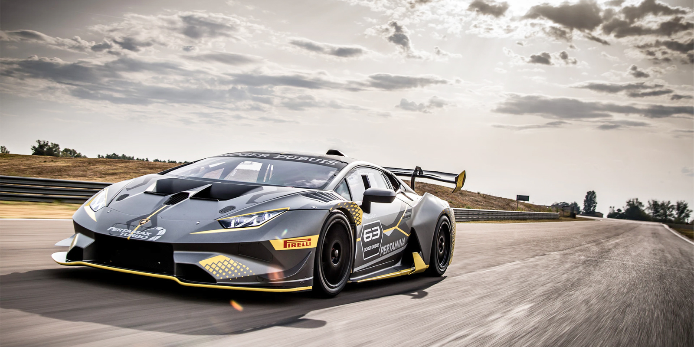

# lamborghini
A responsive single-page website promoting a Lamborghini-themed racing tournament.

## Overview
The project showcases event highlights, schedule details, and featured vehicles through rich visuals and adaptive layouts. It is built with semantic HTML, modular CSS, and lightweight JavaScript to deliver smooth animations and mobile-friendly navigation. Use it as a base template for motorsport or luxury automotive landing pages.

## Site design preview

[Link](https://fixxnull.github.io/lamborghini/)
